# Assignment 3. Responsive Web Design (Media Queries + Bootstrap Grid)

**Name:** Aibergen Amanzhol
**Group:** SE - 2583

---

## Part 1. Media Queries

### Task 0. Responsive Typography
Create a simple webpage with headings and paragraphs. Use media queries to change font sizes for mobile, tablet and desktop.

Files: `task0.html`, `css/task0.css`

**Mobile (less than 576px):**

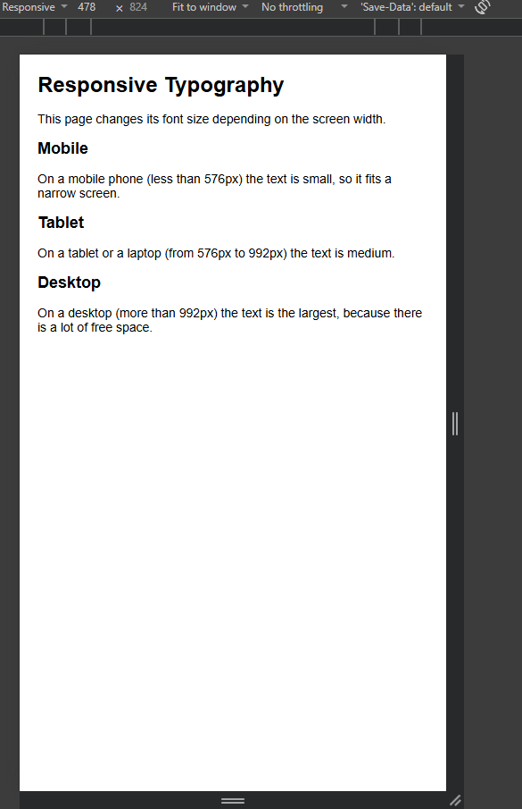

**Tablet (576px - 992px):**

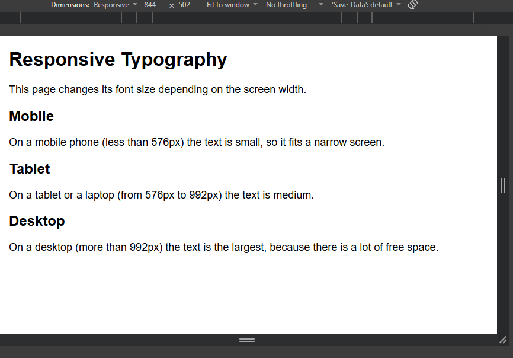

**Desktop (more than 992px):**

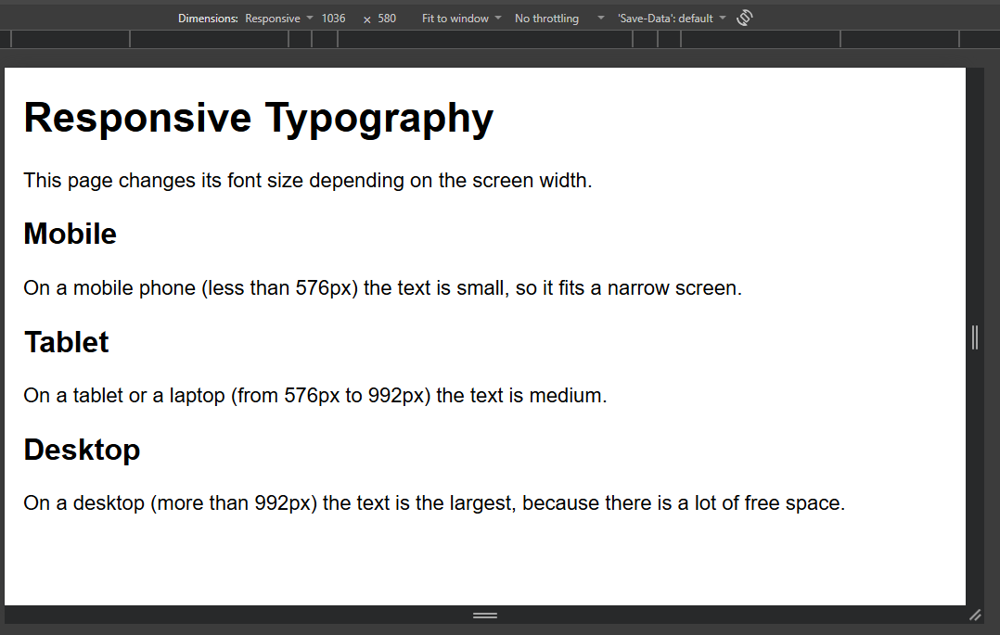

### Task 1. Responsive Layout with Media Queries
Create a webpage with three boxes in a row. On desktop all three boxes are side by side, on tablet two boxes in a row, on mobile the boxes are stacked vertically. Use only CSS media queries (no Bootstrap).

Files: `task1.html`, `css/task1.css`

**Desktop (3 boxes in a row):**

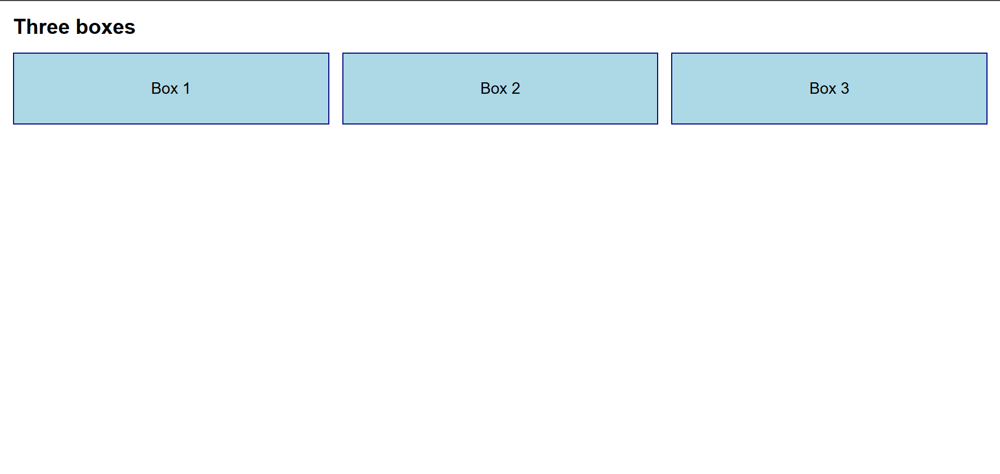

**Tablet (2 boxes in a row):**

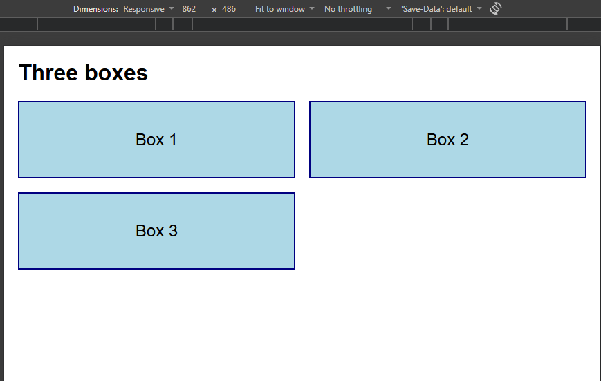

**Mobile (boxes stacked):**

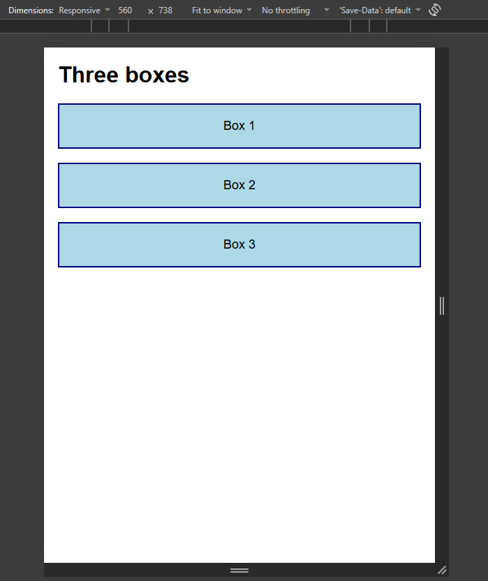

---

## Part 2. Bootstrap Grid System

### Task 2. Bootstrap Responsive Columns
Build a responsive layout using Bootstrap's 12-column grid. On desktop each column takes 4 columns (3 equal parts), on tablet two columns are on the first row and one on the second row, on mobile all columns are stacked. I used the classes `col-12 col-md-6 col-lg-4`.

Files: `task2.html`, `css/task2.css`

**Desktop:**

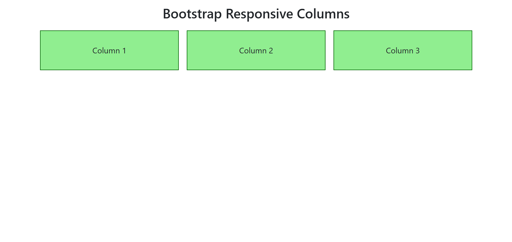

**Tablet:**

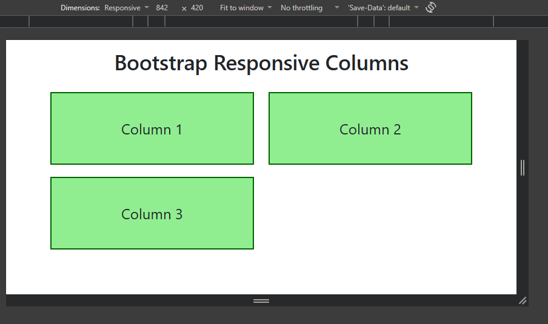

**Mobile:**

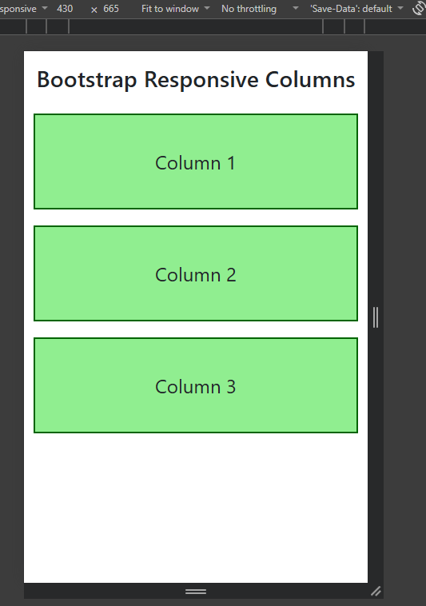

### Task 3. Bootstrap Navigation Bar
Create a responsive navigation bar using Bootstrap components: a logo on the left, links on the right, and a hamburger menu on smaller screens.

File: `task3.html`

**Desktop:**

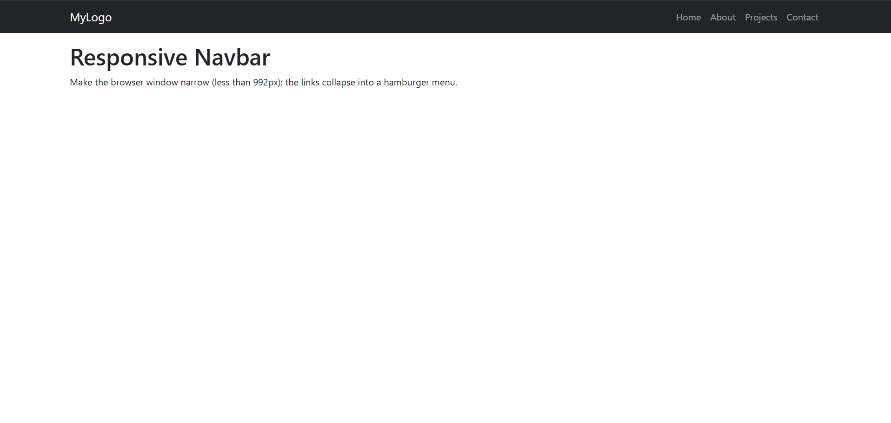

**Mobile (menu closed):**

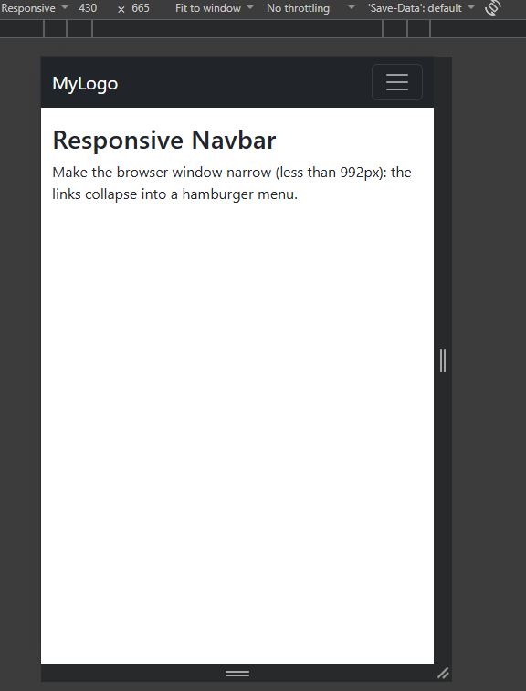

**Mobile (menu open):**

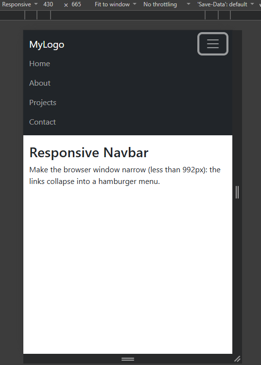

---

## Part 3. Combined Project

### Task 4. Responsive Portfolio Page
Create a portfolio page using both media queries and the Bootstrap grid: a header with a Bootstrap navbar, a main section with project cards on the left and a sidebar with personal info and contacts on the right, a footer at the bottom, and custom media queries for font sizes, spacing and element visibility.

Files: `task4.html`, `css/task4.css`

**Desktop:**

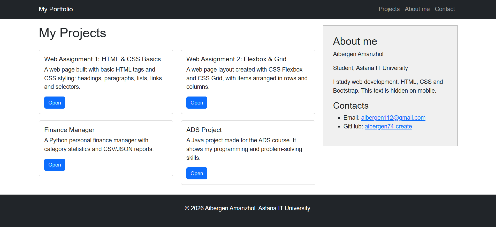

**Tablet:**

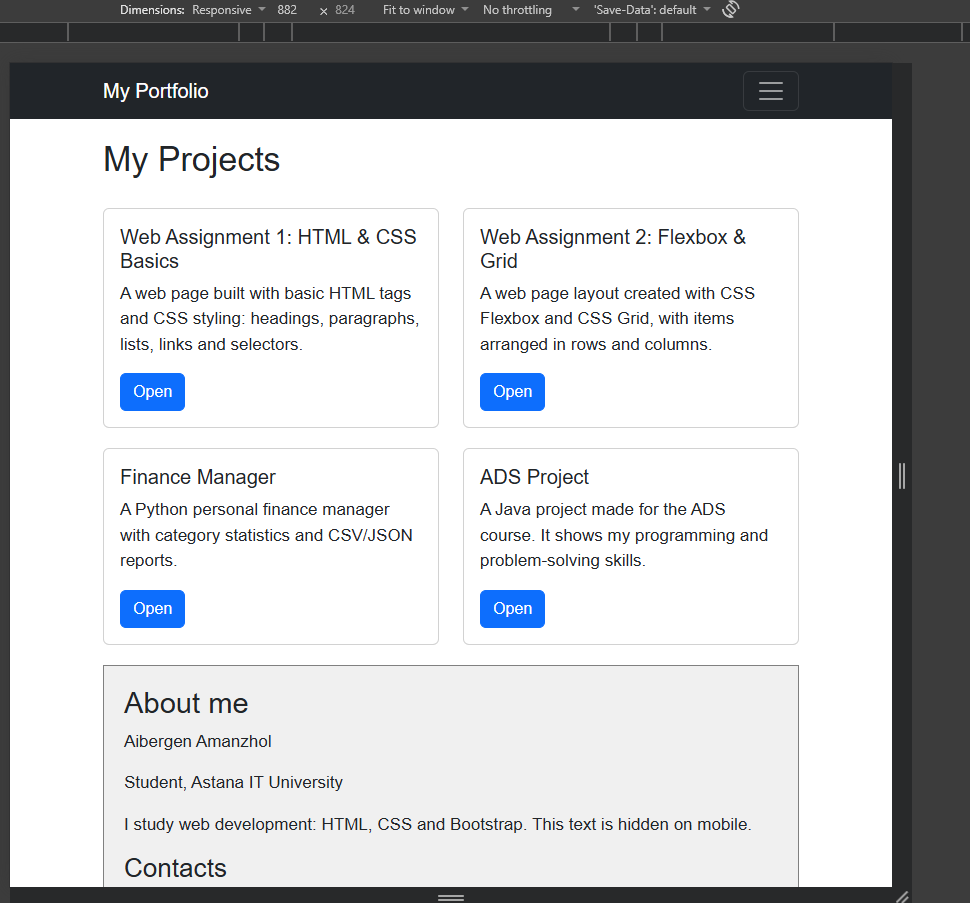

**Mobile:**

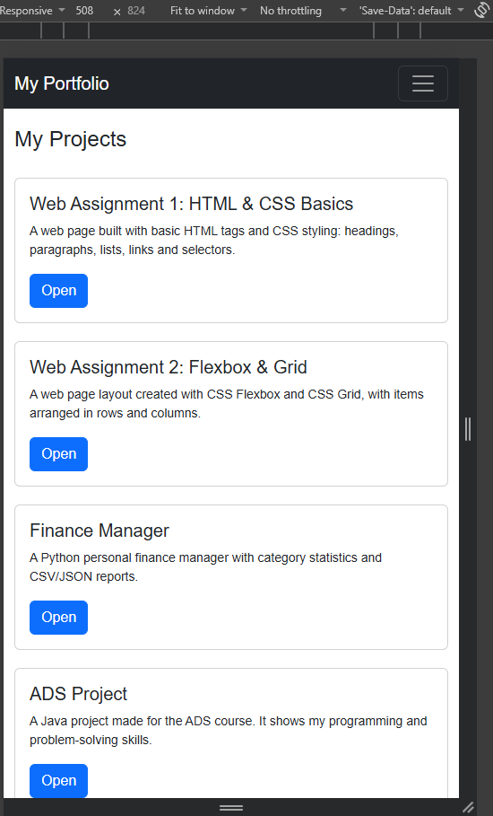

---

## Summary of my work process
In this assignment I made five pages about responsive web design. I wrote the code in VS Code and opened the pages with Live Server. First I did Task 0 and Task 1 using only CSS media queries: I changed the font sizes and the number of boxes in a row for mobile, tablet and desktop. Then I used Bootstrap. In Task 2 I made three columns with the 12-column grid, and in Task 3 I made a navbar that turns into a hamburger menu on small screens. In Task 4 I used both together and made a portfolio page with a navbar, project cards, a sidebar, a footer and my own media queries. I checked every page in Chrome DevTools with different screen widths and took screenshots. At the end I uploaded the project to GitHub.

## Conclusion
In this assignment I learned how to make web pages that look good on a phone, a tablet and a computer. Media queries let me change my own CSS depending on the screen width, for example font sizes, spacing and hidden elements. The Bootstrap grid helps to build a layout fast with ready classes like `col-12 col-md-6 col-lg-4`. I also learned that the Bootstrap navbar collapses into a hamburger menu by itself on small screens. The best result is when I use both together: Bootstrap for the main layout and media queries for small changes.